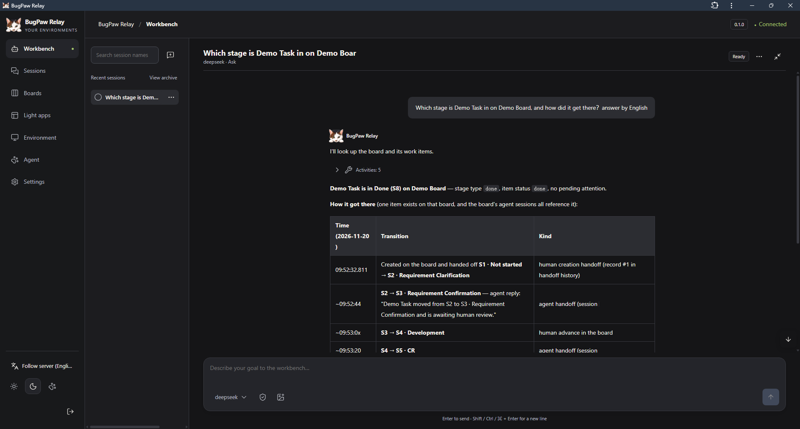
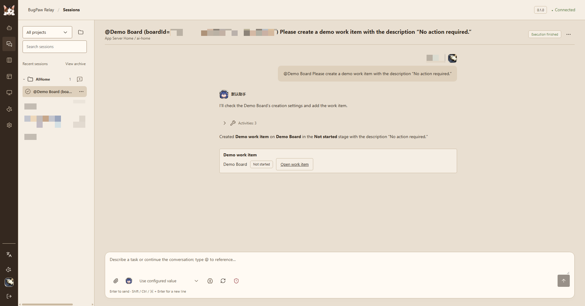
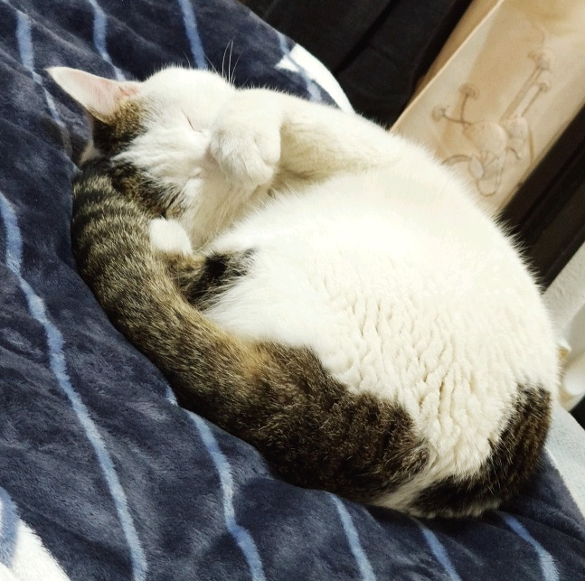

# BugPaw Relay

[简体中文](README.md) · English

Give Codex or Claude Code a task on your own development machine from a phone or browser. Resume a conversation, approve a tool request, or use a board to move work through development, review, and human sign-off. Each work item keeps its stage conversations and delivered files together.

[User guide · Mention a board in a session, create a work item, and open its handoff report](docs/user-guide.en.md)



## 1.0.1 release notes

### Feature highlights

- **Session management** lets you pin sessions across projects, reorder your pins, select a range of sessions, and delete them in batches.
- **Messages and file previews** now render math in conversations, let you copy the original message text, and offer rendered and source views for Markdown attachments. Session files and board handoff artifacts can both open full screen.
- **Light Apps** can call a dedicated HTTP service in the development environment. You can manage apps and switch backends from another session in the same environment. You can also send individual feedback entries to the originating session and retry a failed notification.
- **Approvals and agents.** Approval prompts show the permission scope and forms requested by the coding tool. Acknowledgments confirm delivery of your reply, and automatic decisions appear under the corresponding tool call. When you delete an agent, you can see which board stages still reference it.
- **Environment monitoring** shows CPU, memory, and disk usage alongside traffic sent and received over the last 5 minutes, 1 hour, or 24 hours. Traffic is measured at the development machine’s network interfaces and includes other processes.

### Reduced network traffic

- The browser requests state for the current page. Subsequent refreshes return only data groups that changed. The board list loads summaries, and opening a work item retrieves its full requirements, acceptance criteria, and handoffs. This reduces repeated transfers while a page is idle.
- Live events deliver incremental session output without repeatedly fetching the entire conversation from the development machine. The client checks the environment’s history as needed when you open a session, reconnect, or reach the end of a run so it can recover missing messages.

## Main features

| Section | What you can do |
| --- | --- |
| Workbench | Ask the platform assistant about an environment or a task. For example, “Which stages did Demo Task go through?” |
| Sessions | Choose a project and working directory, chat with Codex or Claude Code, handle tool approvals, and open generated files. |
| Boards | Organize work into agent stages and human reviews. Follow each item through its stage conversations and handoff artifacts. |
| Light apps | Open an interactive demo or tool published from a session, try a specific version, and leave feedback on it. |
| Environment | Connect a development machine, check its connector status and version, and manage registered environments. |
| Agent | Define what an agent is responsible for in a development environment, then select it for a project session or board stage. |
| Settings | Choose the model for the workbench assistant and manage account security, including two-factor authentication. |

## How it works

- **Your development machine** runs the environment connector and the coding CLI. The connector opens an outbound connection to your server and runs tasks in the project directory you choose. Its identity key, tool credentials, and native session history stay on that machine.
- **Your self-hosted server** provides a single-user workspace for environments, projects, session indexes, and boards. Files delivered at a board handoff are stored as snapshots, so you can download them even when the development machine is offline.
- **Your browser** is where you work. Start a task on a desktop and open the same session on your phone to approve a request. You can install the mobile interface as a PWA. Sending messages and approving requests require a connection.

Type `@` in a project session, select a board, and ask the agent to turn your discussion into a work item. You can specify a starting stage and open the resulting card directly from the conversation. When the item enters an agent stage, its assigned agent starts work. If artifact delivery is enabled, a reviewer can open the report from the handoff history and follow the link to the stage session.



## Start the server from source

Run these commands from the repository root on a Linux x64 build host. Install Docker, Node.js 24.19.0, npm, gcc, the MinGW-w64 x64 C compiler, curl, GNU tar, xz, zip, and unzip. Packaging requires access to the npm registry and Node.js downloads. Build both connector packages before building the server image, which includes them as downloads.

```sh
npm ci
npm run build
npm run package:connector
docker build -t bug-paw-relay:local .
```

### Use it on one computer

If your projects and coding CLI are on the same computer, register it as your only development environment. Docker runs the main site. Run the connector and CLI on the host under your usual development account so they can use your project directories directly. The browser and connector reach the server over loopback without a public IP, domain, certificate, or reverse proxy. Dependency downloads and cloud model requests still need outbound access.

With the image built above, run the following commands. The Docker volume persists server data such as your account and boards. The temporary container gives the service account write access to the volume.

```sh
docker volume create bugpaw-relay-local-data
docker run --rm --user 0 -v bugpaw-relay-local-data:/data bug-paw-relay:local chown 1000:1000 /data
docker run -d --name bugpaw-relay-local -p 127.0.0.1:3180:3180 -v bugpaw-relay-local-data:/data -e RELAY_PUBLIC_URL=http://127.0.0.1:3180 -e RELAY_INSECURE_COOKIE=true bug-paw-relay:local
docker exec bugpaw-relay-local cat /data/setup-token
```

Open `http://127.0.0.1:3180` in your browser and use the setup token to create the administrator account with a password of at least 12 characters. Follow “Connect a development machine” below to register this computer. Enter **the same URL** in the connector and choose a working root containing your local projects. Later, use `docker stop bugpaw-relay-local` and `docker start bugpaw-relay-local` to stop and start the server.

This setup supports sessions, approvals, and boards. To open Light Apps, use the two-service HTTPS deployment below with a separate Light App hostname. Use the HTTP cookie setting above only on loopback.

### Serve the main site and Light Apps over HTTPS

The [Compose deployment](compose.yaml) runs the main site and the Light App host from one image. With the reverse proxy on the Docker host, replace the two example hostnames with your HTTPS sites. Forward the main site to `127.0.0.1:3180` with WebSocket upgrades on `/api/node/connect`, and the Light App site to `127.0.0.1:3181`.

```sh
export RELAY_PUBLIC_URL=https://relay.example.com
export RELAY_LIGHT_DOMAIN=apps.example.com
export RELAY_LIGHT_KEY="$(openssl rand -hex 32)"
sudo install -d -m 700 -o 1000 -g 1000 /srv/bug-paw-relay/relay /srv/bug-paw-relay/light-host
docker compose up -d --wait
docker compose exec relay cat /data/setup-token
```

Generate the shared key once. Keep all three environment variables in protected deployment configuration for subsequent starts. Include both service data directories in backups.

Open your HTTPS URL and enter the one-time token printed in your terminal to initialize the administrator account. Choose a password of at least 12 characters. You can enable TOTP after signing in.

## Connect a development machine and start a session

1. The connector includes Node.js. For Codex, install Codex CLI under the connector account and use official sign-in or a custom Responses endpoint. For Claude, select the local Claude Code or custom API mode in the connector console and install the required components when prompted.
2. Sign in to the server, open **Environments**, download the full package for your platform, and extract it. On Windows x64, double-click `bugpaw-relay.exe`. On Linux x64, run `./bugpaw-relay` to open the local configuration page. On headless Linux, use `./bugpaw-relay configure`, then the `register` and `start` commands.
3. Enter the server URL used by your browser in the connector (`http://127.0.0.1:3180` for local use) and set the allowed working roots. Generate a one-time registration code in **Environments**, use it to register the connector, then approve the environment on the server. Check that it appears online.
4. Open **Sessions**, choose a project and a directory on that machine, and start an environment session with the agent you configured. Try asking, “List the top-level directories in this project and suggest where I should start reading.” Continue in the same session when the reply arrives.

Windows 11 x64 and Ubuntu 22.04/24.04 LTS x64 are the target platforms. Full installation and live model checks still need verification on the target systems. Working roots limit which directories you can select through the platform. Commands run with the permissions of the local account and coding tool.

## Operations and development

- **Upgrades and backups.** Keep the previous image. Stop the server and back up its entire mounted data directory, including databases, the master key, and artifacts. Back up connector identity and sessions separately on the development machine. Check the protocol and data format before upgrading older connectors. [Connector updates](docs/connector-updates.md) · [Storage and connection diagnostics](docs/connector-diagnostics.md)
- **Contributing.** Use Node.js 24. After installing dependencies, run `npm run typecheck`, `npm test`, and `npm run build`. Native protocol tests need the corresponding CLI on the test account’s PATH. Run the full permission tests as a non-root user. When reporting a problem, include the OS, version, and steps to reproduce it.
- **Further reading.** [Installation scripts, CLI commands, permissions, file transfers, and board handoffs (Chinese)](docs/usage-reference.zh-CN.md)

## Roadmap

These are candidate directions. Scope and order will depend on feedback from people running their own instances.

| Direction | What it would enable |
| --- | --- |
| First-time setup and image distribution | Install a versioned public image and pinpoint the failing step when a connection or sign-in fails. |
| Shareable board templates | Share a development and review workflow that others can bind to their own environments and projects. |
| Notifications | Receive a webhook when an approval or human handoff needs attention, with a link to the session. |
| Multiple accounts | Share projects within a team, assign approval permissions by role, and see who took an action. |
| Tenant isolation | Host independent teams on one instance, each with its own environments, credentials, sessions, and artifacts. |

## License

BugPaw Relay is distributed under the Apache License 2.0. BugPaw artwork retains its original license, and bundled third-party components retain their respective licenses. [LICENSE](LICENSE) · [NOTICE](NOTICE) · [Artwork license](public/assets/LICENSE-BugPaw.txt)

## Meet Bug

<p align="center">
  
</p>
<p align="center"><sub>Everything is running. Bug is taking a nap.</sub></p>
