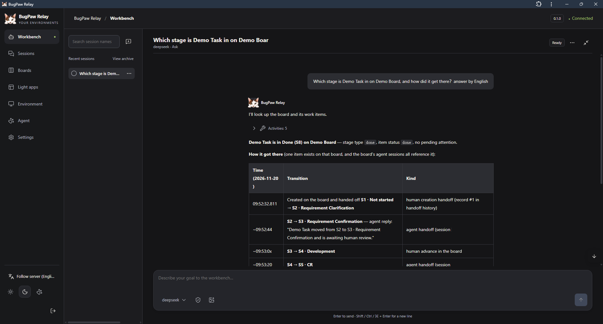
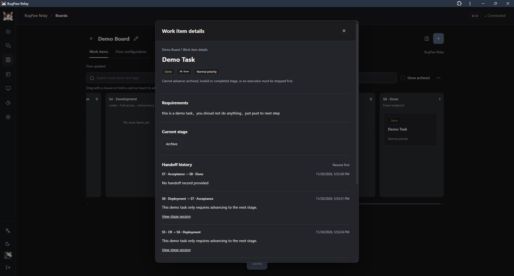
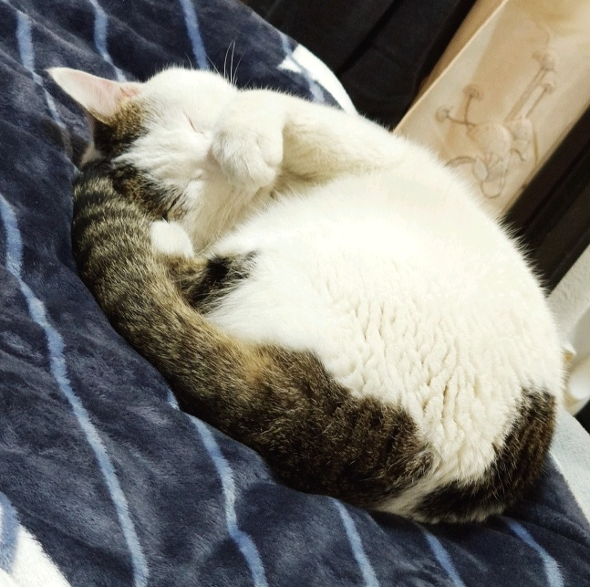

# BugPaw Relay

简体中文 · [English](README.en.md)

在手机或浏览器里，把任务交给自己开发机上的 Codex 或 Claude Code。你可以继续昨天的会话、处理工具审批，也可以用看板把开发、审查和人工验收串起来，从工作项回看每一步的对话和交付文件。



## 主要模块

| 入口 | 可以做什么 |
| --- | --- |
| 工作台 | 向平台助手询问环境状态或任务进度，例如“Demo Task 经过了哪些阶段？” |
| 会话 | 选择项目和工作目录，与 Codex 或 Claude Code 对话，处理工具审批并查看生成的文件。 |
| 看板 | 为工作项安排 Agent 阶段和人工检查，跟踪进度，查看各阶段的会话和交接产物。 |
| 轻应用 | 打开 Agent 在会话中发布的交互演示或小工具，体验具体版本并留下反馈。 |
| 环境 | 接入开发机，查看连接器的在线状态和版本，管理已注册的环境。 |
| 智能体 | 为开发环境中的 Agent 配置职责，供项目会话和看板阶段使用。 |
| 设置 | 配置工作台助手使用的模型，管理账号安全和双重验证。 |

## 它怎样工作

- **开发机**运行环境连接器和编码 CLI。连接器主动连到你的服务端，在你选择的项目目录中执行任务。本机保留环境身份私钥、工具凭据和原生会话。
- **自托管服务端**提供单用户工作台，管理环境、项目、会话索引和看板。Agent 提交到看板的交接产物会保存为快照，开发机离线后仍可下载。
- **浏览器**是日常操作入口。可以在桌面发起任务，再在手机上打开同一条会话处理审批。移动端支持安装为 PWA，发送消息和执行审批需要联网。

例如，要给项目补一份安装说明，可以先在看板上建一个工作项。开发阶段的 Agent 在指定目录修改文档，提交交接记录后进入人工检查阶段。你可以从同一张卡片打开会话，查看它改了什么，再决定是否完成。



## 从源码启动服务端

以下命令在 Linux x64 构建机的仓库根目录运行。准备 Docker、Node.js 24.19.0、npm、gcc、MinGW-w64 的 x64 C 编译器、curl、GNU tar、xz、zip 和 unzip。打包时需要访问 npm 和 Node.js 下载源。服务镜像内含 Windows 和 Linux 连接器，先打包再构建镜像。

```sh
npm ci
npm run build
npm run package:connector
docker build -t bug-paw-relay:local .
```

### 只在自己的电脑上使用

如果项目和编码 CLI 都在这台电脑上，直接把它注册成唯一的开发环境即可。Docker 运行主站，连接器和 CLI 用你平时开发的系统账号在宿主机运行，项目目录无需挂载进容器。浏览器和连接器都访问本机回环地址，无需公网 IP、域名、证书或反向代理。下载依赖和调用云模型仍需要出站网络。

准备好上面的镜像后执行以下命令。Docker 卷保存账号、看板等服务端数据，第一条临时容器命令为服务账户设置卷权限。

```sh
docker volume create bugpaw-relay-local-data
docker run --rm --user 0 -v bugpaw-relay-local-data:/data bug-paw-relay:local chown 1000:1000 /data
docker run -d --name bugpaw-relay-local -p 127.0.0.1:3180:3180 -v bugpaw-relay-local-data:/data -e RELAY_PUBLIC_URL=http://127.0.0.1:3180 -e RELAY_INSECURE_COOKIE=true bug-paw-relay:local
docker exec bugpaw-relay-local cat /data/setup-token
```

在本机浏览器打开 `http://127.0.0.1:3180`，使用初始化令牌创建管理员账号（密码至少 12 位）。接着按下文「接入开发机」注册这台电脑，连接器的服务端地址也填写 **同一个 URL**，工作根目录选择本机项目所在目录。后续用 `docker stop bugpaw-relay-local` 和 `docker start bugpaw-relay-local` 停启。

此配置可使用会话、工具审批和看板。需要打开轻应用时，采用下方带独立 HTTPS 域名的双服务部署。上面的 HTTP Cookie 设置仅适用于回环地址。

### 通过 HTTPS 使用主站和轻应用

[Compose](compose.yaml) 从同一镜像启动主站和轻应用托管服务。以下示例假设反向代理与 Docker 同机。将示例域名换成自己的两个 HTTPS 站点，主站代理到 `127.0.0.1:3180` 并支持 `/api/node/connect` WebSocket 升级，轻应用域名代理到 `127.0.0.1:3181`。

```sh
export RELAY_PUBLIC_URL=https://relay.example.com
export RELAY_LIGHT_DOMAIN=apps.example.com
export RELAY_LIGHT_KEY="$(openssl rand -hex 32)"
sudo install -d -m 700 -o 1000 -g 1000 /srv/bug-paw-relay/relay /srv/bug-paw-relay/light-host
docker compose up -d --wait
docker compose exec relay cat /data/setup-token
```

首次生成共享密钥后，将三个环境变量保存在部署机受保护的配置中，后续启动时复用。备份时同时保存两个服务的数据目录。

在浏览器打开该 HTTPS 地址，用终端显示的一次性令牌初始化管理员账号，设置至少 12 位的密码。登录后可启用 TOTP 双重验证。

## 接入开发机，发起第一条会话

1. 连接器包自带 Node.js。使用 Codex 时，为运行连接器的账号安装 Codex CLI，并选择官方登录或自定义 Responses 端点。使用 Claude 时，在连接器控制台选择环境 Claude Code 或自定义 API 模式，再按提示安装所需组件。
2. 登录服务端，在「环境」页下载对应的完整包并解压。Windows x64 双击 `bugpaw-relay.exe`，Linux x64 运行 `./bugpaw-relay` 打开本机配置页。无桌面的 Linux 可用 `./bugpaw-relay configure` 配置，并用 `register` 和 `start` 注册和启动。
3. 在连接器中填写浏览器使用的服务端地址（单机模式填 `http://127.0.0.1:3180`），设置允许访问的工作根目录。在服务端「环境」页生成一次性接入码，在开发机上用它注册，再回到服务端批准环境。确认环境在线。
4. 在「会话」中选择项目和该环境内的工作目录，新建环境会话并选择已配置的 Agent。试着发送“请列出当前项目的顶层目录，并说明从哪里开始阅读”。收到回复后，可以留在同一条会话里继续工作。

Windows 11 x64、Ubuntu 22.04/24.04 LTS x64 是目标验证平台。包可用性、操作系统实机验收和真实模型调用分别验证。工作根目录限制平台可选路径，命令执行权限仍由本机账户及编码工具控制。

## 运维与开发

- **升级与备份**：保留旧镜像，停服后完整备份挂载的服务端数据目录，其中包括数据库、主密钥和产物。连接器的身份和会话需在开发机上单独备份。旧连接器升级前先核对协议与数据格式。[连接器更新](docs/connector-updates.md) · [存储与连接诊断](docs/connector-diagnostics.md)
- **参与开发**：使用 Node.js 24，安装依赖后运行 `npm run typecheck`、`npm test` 和 `npm run build`。原生协议测试需要测试账户能从 PATH 找到相应 CLI，完整权限用例使用普通账户。反馈问题时，请附操作系统、版本和可复现步骤。
- **使用参考**：[安装脚本、CLI、权限、文件传输与看板交接](docs/usage-reference.zh-CN.md)

## 路线图

以下是正在考虑的方向，具体范围和顺序取决于自托管用户的反馈。

| 方向 | 想解决的问题 |
| --- | --- |
| 首次接入与镜像分发 | 通过版本固定的公共镜像安装，遇到连接或认证问题时能够定位失败的步骤。 |
| 可分享的看板模板 | 将开发与审查流程分享给其他人，由对方绑定自己的环境和项目。 |
| 待处理通知 | 需要审批或人工交接时，通过 Webhook 收到能打开对应会话的提醒。 |
| 多账号协作 | 让团队成员共享项目，按角色处理审批，并查看操作记录。 |
| 多租户隔离 | 让多个团队共用一个实例，各自管理环境、凭据、会话和产物。 |

## 许可

BugPaw Relay 采用 Apache License 2.0。BugPaw 品牌素材保留原始许可，随包分发的第三方组件沿用各自的许可。[LICENSE](LICENSE) · [NOTICE](NOTICE) · [品牌素材许可](public/assets/LICENSE-BugPaw.txt)

## Bug 本 Bug

<p align="center">
  
</p>
<p align="center"><sub>功能跑完了，Bug 先睡一会儿。</sub></p>
