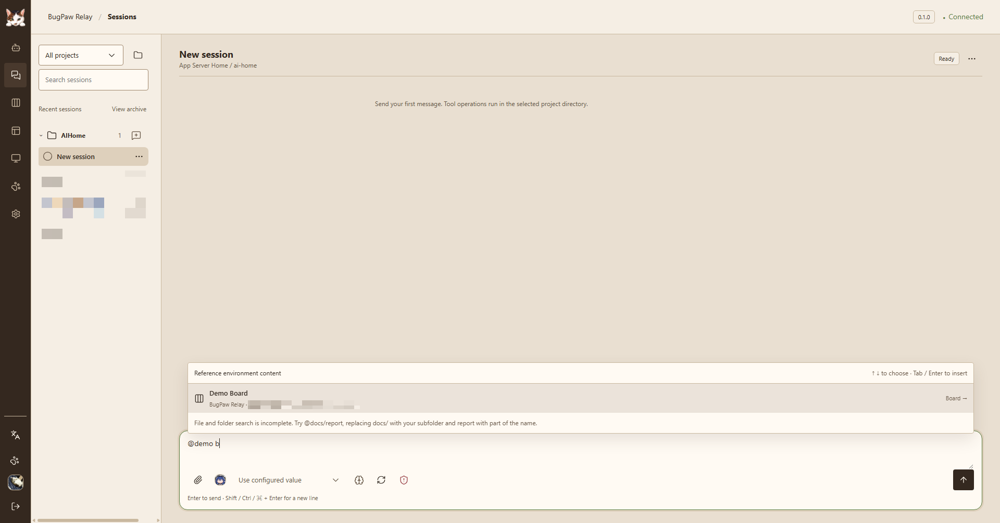
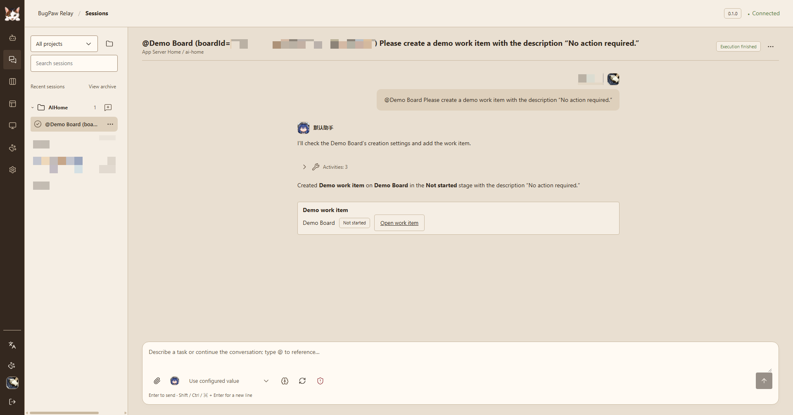
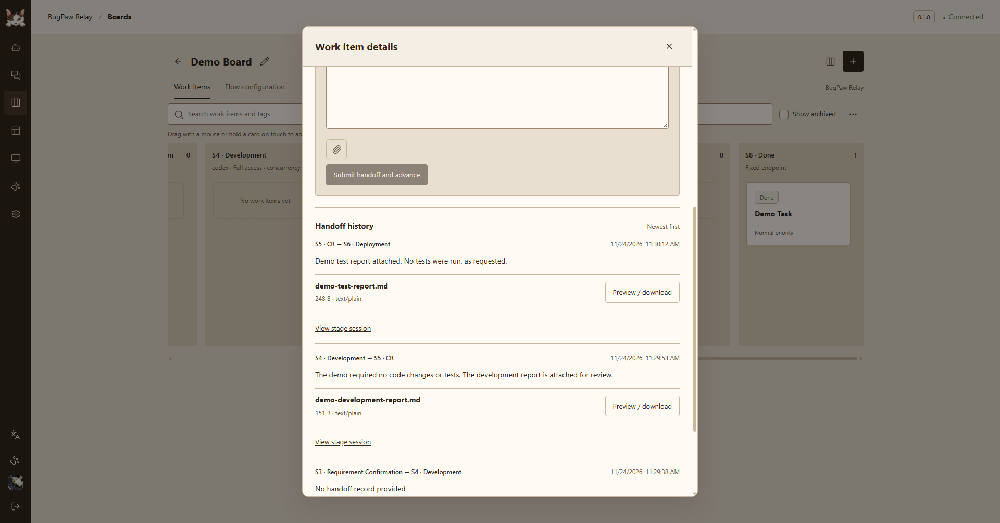
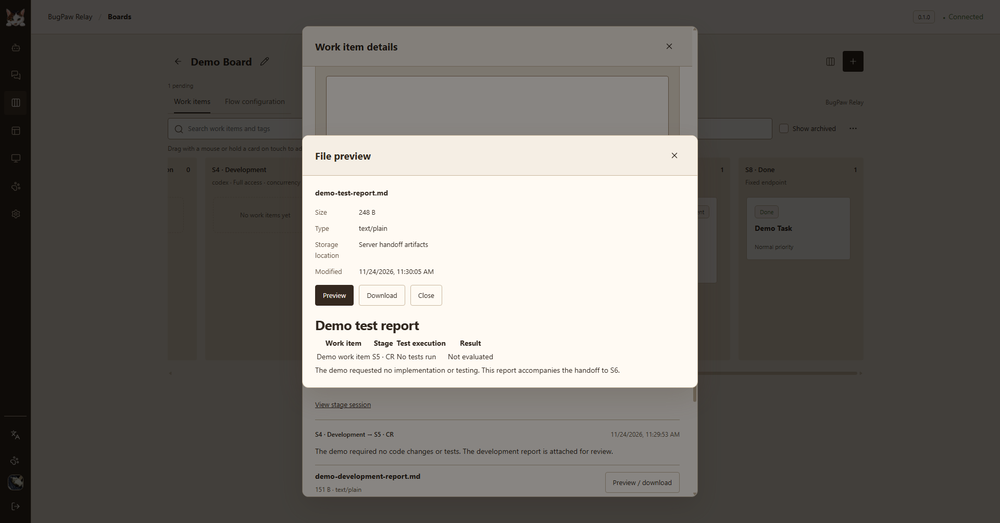

# BugPaw Relay user guide

[Project home](../README.en.md) · [简体中文](user-guide.zh-CN.md)

Follow a work item from the conversation where you create it to the report you open at review. If you can already chat with an agent in your project, start with section 2.

## 1. Start your first session on one computer

1. Start the main site in Docker, open `http://127.0.0.1:3180` in your browser, and use the setup token to create your account. Run the connector and coding CLI under your usual development account. Your project directory stays on the host. [Local deployment commands](../README.en.md#use-it-on-one-computer)
2. In **Environment**, download and extract the connector for your platform. Run `bugpaw-relay.exe` on Windows or `./bugpaw-relay` on Linux. In the local console, enter the same server URL you opened in the browser and add a working root containing your project. For a separate development machine, use an HTTPS URL reachable from that machine. [HTTPS deployment](../README.en.md#serve-the-main-site-and-light-apps-over-https)
3. Generate a registration code on the server’s **Environment** page. Register the connector with it, approve the environment on the server, and check that it is online. For Codex, check that the connector account can run and sign in to Codex CLI. For Claude, select the mode on the connector’s CLI tools tab, install the required components, and authenticate for that mode.
4. Open **Sessions**, create or select a project, bind it to the environment and working directory, and start a session with your configured agent. Ask “List the top-level directories in this project.” Check the reply against the directories on your machine.

## 2. Create a work item from a conversation

Create or choose a practice board under **Boards**. The screenshots use **Demo Board**. To try delivering a report, open **Flow configuration**, assign an environment, project directory, and agent to a development or review stage, and make human review reachable in your workflow. Enable artifact delivery for each agent stage that should submit a report.

Return to your project session, type `@demo` in the message box, and select **Demo Board** from the suggestions. For your own board, type part of its name.

With the board selected, send the message below. If prompted to approve the write, check the board and the proposed item before approving.

> Please create a demo work item with the description “No action required.”

The agent creates **Demo work item** and returns a card in the conversation. Select **Open work item** to see the details. The request left the starting stage unspecified, and this board placed the item in **Not started**. For another task you could add “Start in the Development stage.” Selecting an agent stage queues the item for execution.

## 3. Follow a handoff and open the report

Open the item details. At a human stage, choose an allowed next stage and submit the handoff. When the item enters an agent stage, the assigned agent takes over. Ask the Workbench “Which stage is Demo work item in on Demo Board?” or inspect **Handoff history** on the card. If several items will modify the same repository in parallel, give them separate Git worktrees.

To reproduce the reports shown below, add a delivery instruction to the relevant stage, such as “At handoff, attach a Markdown report describing the work performed and any tests run.” Artifact delivery is off by default. Enabling it applies to new executions. In the example, development delivered a development report, and review delivered a test report. Each file appears under the handoff that produced it. Select **View stage session** to read that conversation.

Select **Preview / download** next to `demo-test-report.md`. The demo requested no action, so its report records **No tests run**. For a real review, read the report before advancing the item. The server keeps a snapshot of each delivered file, which you can open even when the development machine is offline.

For supported file formats, size limits, and stage configuration details, see the [usage reference (Chinese)](usage-reference.zh-CN.md).
