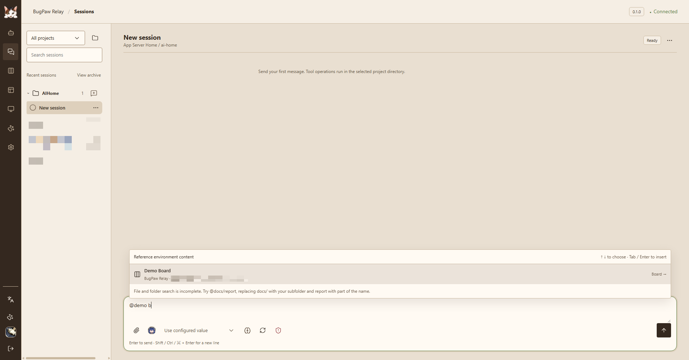
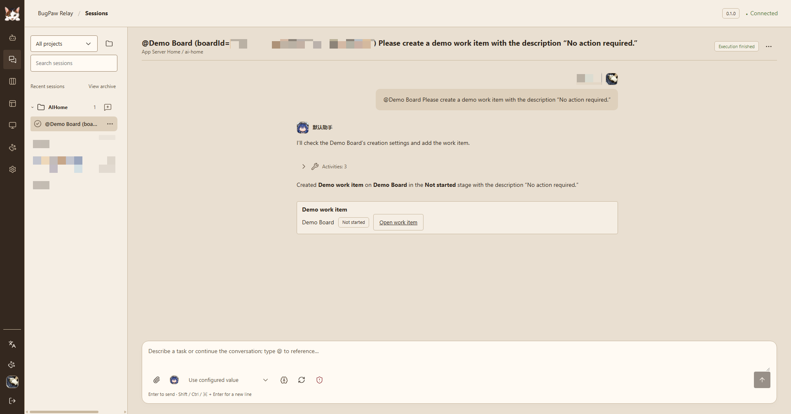
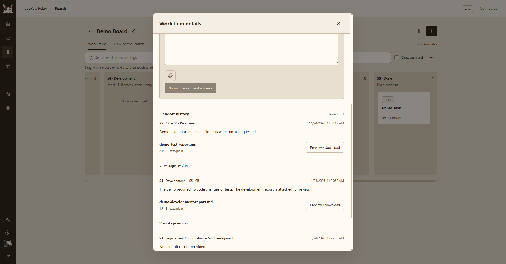
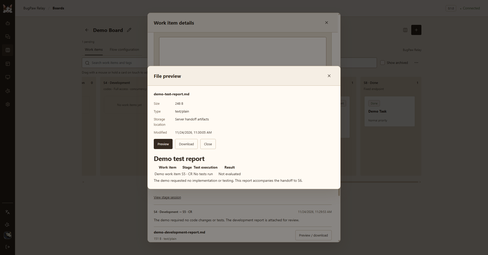

# BugPaw Relay 使用手册

[项目首页](../README.md) · [English](user-guide.en.md)

本教程用同一张工作项卡片走一遍日常流程：在项目会话里引用看板，请 Agent 建卡，再打开各阶段留下的报告。如果你已经能在项目里和 Agent 对话，可以直接从第二节开始。

## 1. 在自己的电脑上发起第一条会话

1. 按单机部署步骤启动 Docker 主站，在本机浏览器打开 `http://127.0.0.1:3180`，用首次初始化令牌创建账号。连接器和编码 CLI 都由你平时开发的系统账号运行，项目目录留在宿主机。[单机部署命令](../README.md#只在自己的电脑上使用)
2. 在「环境」页下载对应平台的连接器并完整解压。Windows 运行 `bugpaw-relay.exe`，Linux 运行 `./bugpaw-relay`。在本机控制台填写与浏览器相同的服务端地址，添加一个包含项目的工作根目录。多机部署时使用开发机可达的 HTTPS 地址。[HTTPS 部署](../README.md#通过-https-使用主站和轻应用)
3. 在服务端「环境」页生成接入码，在连接器用它注册，再回到服务端批准环境。确认状态为在线。使用 Codex 时确认该账户能运行并登录 Codex CLI。使用 Claude 时，在连接器的 CLI 工具页选择模式，按提示安装组件并完成对应认证。
4. 打开「会话」，创建或选择项目，绑定环境及工作目录，使用已配置的 Agent 新建会话。发送“请列出这个项目的顶层目录”。收到与你本机目录一致的回复，就可以开始下面的练习。

## 2. 从对话创建工作项

先在「看板」中创建或选用一块练习看板。截图中它叫 **Demo Board**。如果要跟着练习交付报告，在「流程配置」中为开发或审查阶段指定环境、项目目录和 Agent，将人工验收设为可达的后续阶段，并提前为要交报告的 Agent 阶段开启「允许提交产物」。

回到项目会话，在输入框键入 `@demo`，从候选列表中选中 **Demo Board**。使用自己的看板时，输入其名称即可。

选中看板后输入下面这句话并发送。若出现写操作审批，核对目标看板及建卡内容后批准。

> 请创建一个演示工作项，描述为“无需执行任何操作”。

截图中的 Agent 创建了 **Demo work item**，会话随即显示工作项卡片。点击 **Open work item** 可以打开详情。这里没有指定起点，卡片显示 **Not started**（未开始）。要让另一个任务直接从开发开始，建卡时可以写“从开发阶段开始”。选择 Agent 阶段后，工作项会进入执行队列。

## 3. 跟踪阶段并打开交付报告

打开工作项详情，在人工阶段选择流程允许的下一阶段并提交交接。进入 Agent 阶段后，由该阶段配置的 Agent 执行。你可以在工作台问“Demo Board 上的 Demo work item 到了哪一步？”，也可以直接查看卡片的**交接历史**。多个工作项需要并行修改同一仓库时，为它们安排独立的 Git 工作树。

如果要重现图中的报告，在相应阶段的指令中写清交付要求，例如“在交接时提交一份 Markdown 报告，记录本阶段做了什么、运行了哪些测试”。产物开关默认关闭，开启后对新执行生效。图中开发阶段交付了开发报告，审查阶段交付了测试报告。每份文件都列在对应的交接记录下。点 **View stage session** 可以查看那一步的对话。

在测试报告旁点 **Preview / download**，打开 `demo-test-report.md`。这条演示任务要求无需操作，因此报告记录了 **No tests run**。实际验收时，先读报告，再决定是否推进到下一阶段。已交付的文件作为快照保存在服务端，开发机离线后仍可打开。

需要核对文件格式、大小限制或已有阶段的配置规则时，参阅[使用参考](usage-reference.zh-CN.md)。
